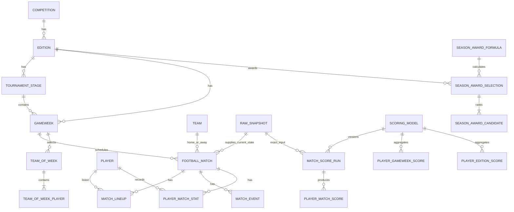

# Data model

This model supports APF ingestion, correction history, versioned scoring,
position-filtered leaderboards, authentication, and Team of the Week. The
executable PostgreSQL definition is in [`db/schema.sql`](db/schema.sql).

## Decisions and terminology

1. **PostgreSQL is authoritative; Redis is a planned rebuildable read model.**
   Raw data, current normalized data, scoring inputs, formula versions, and
   published selections remain in PostgreSQL. The Redis read model described in
   [Redis leaderboard model](#redis-leaderboard-model) is **not implemented**:
   no process writes sorted sets, so the reader in
   `internal/leaderboard/redis.go` only returns data if a writer is added. The
   web process currently serves the default scoring model from a short-lived
   in-process cache instead.
2. **A product “round” is an APF gameweek.** APF also calls the regular
   competition phase a `round`; that concept is stored as `tournament_stage` to
   prevent the two meanings from being mixed.
3. **Leaderboards rank football players, not application users.** Users only
   authenticate under the current requirements. If a fantasy/prediction game is
   added later, it needs separate user-entry and user-score tables.
4. **Internal UUIDs are canonical.** Every APF UUID is retained in
   `source_entity`. Names, shirt numbers, and current team are never identity
   keys.
5. **Missing statistics stay `NULL`.** A missing APF/Opta field means “not
   published,” while `0` means an explicit zero. Percentages are derived from
   completed/attempted counts and are not persisted as source facts.
6. **Scores use integer millipoints.** `1250` means 1.250 points. This avoids
   decimal/float disagreement and remains exactly representable as a Redis
   sorted-set score. Formula results are rounded once, when a match score is
   calculated.
7. **Time is stored as `timestamptz` in UTC.** Source-local fixture times must be
   interpreted using `America/Asuncion` before conversion.

## Entity overview



## Data areas

### 1. Source and audit data

- `data_source`: APF now; licensed validation sources can be added later.
- `raw_snapshot`: immutable discovery, gameweek, or match response, including
  fetch time, URL, source scope, SHA-256, and JSON/body URI.
- `source_entity`: maps `(source, entity type, source ID)` to an internal UUID.

Insert a new raw snapshot only for a material payload. Never update or delete an
old snapshot. A correction creates a new snapshot; normalized tables then point
to the newest snapshot they represent. This gives the project a correction
history even though APF does not publish one.

`source_entity` is deliberately generic so future source aliases do not require
schema changes. Because a generic UUID cannot have a normal foreign key to many
entity tables, the ingestion service must validate that `canonical_id` exists
in the table named by `entity_type`.

### 2. Competition and identity

- `competition` → `edition` → `tournament_stage` → `gameweek`.
- `team`, `player`, and `venue` hold canonical display data.
- `player_edition_profile` resolves the player's edition-level position group:
  goalkeeper (`GK`), defender (`DEF`), midfielder (`MID`), or forward (`FWD`).

Position is a classification, not identity. Preserve the source's detailed
formation place in `match_lineup.formation_place`, then map it to a position
bucket. The recommended resolution order is:

1. an official APF primary position, if present;
2. the position group in which the player accumulated the most minutes;
3. a reviewed manual override;
4. unresolved (`NULL`).

A tied minutes result uses the previous resolved position, then a manual review;
it must not be guessed from a player name or shirt number. The
provider-independent default algorithm requires a resolved position, so
unresolved players remain outside both the overall and position-filtered
leaderboard until resolved. Match and gameweek scores retain the position used
at the time of calculation, making old selections explainable.

### 3. Match facts

- `football_match`: teams, gameweek, venue, kickoff, status, period, and scores.
- `match_lineup`: one player per match, with team, starter/substitute, captain,
  shirt number, formation place, and resolved position.
- `match_event`: ordered goals, cards, substitutions, and other events.
- `player_match_stat`: the stable canonical statistic subset plus all provider
  fields in `raw_stats`. A nullable provider-published `rating` may be retained
  for provenance, but the default v3 rating and awards never use it.
- `team_match_stat`: complete raw team metrics.

The normalized tables are the latest projection. Apply one snapshot in a single
transaction, replacing/marking stale child rows and changing
`last_snapshot_id`. The immutable snapshot—not mutable normalized rows—is the
historical record.

Do not infer a lineup appearance from a statistics row or vice versa: APF can
publish substitutes in the lineup without a player-stat row. Managers should
be separated during normalization and must not be inserted as players.

### 4. Scoring and aggregates

- `scoring_model`: immutable formula document and explicit version.
- `match_score_run`: exact combination of formula version, match, input
  snapshot, and input hash.
- `player_match_score`: result and metric-by-metric explanation in `breakdown`.
- `player_gameweek_score`: current aggregate for one product round.
- `player_edition_score`: current global/season aggregate.

Publishing a corrected run is atomic:

1. calculate against a specific `raw_snapshot`;
2. insert the run and player score rows;
3. mark the former run `superseded`/not current and the new run current;
4. recompute affected gameweek and edition aggregates from current published
   runs (do not increment/decrement from an unknown prior state);
5. increment each changed aggregate's `aggregate_version`;
6. write `leaderboard_outbox` rows in the same transaction.

Only active, published formula versions may be exposed. Editing a formula after
publication is forbidden; create the next version instead. Match scoring and
Team of the Week policies remain versioned JSON so their future shape is not
prematurely fixed. Season-award formulas use the same immutable approach and
have a published v3 specification in [`../docs/season-awards.md`](../docs/season-awards.md).

A canonical leaderboard query is:

```sql
SELECT player_id,
       points_milli,
       rank() OVER (ORDER BY points_milli DESC) AS competition_rank,
       row_number() OVER (
           ORDER BY points_milli DESC, player_id DESC
       ) AS ordinal_rank
FROM player_edition_score
WHERE scoring_model_id = $1
  AND edition_id = $2
  AND ($3::text IS NULL OR position_code = $3)
ORDER BY points_milli DESC, player_id DESC;
```

`competition_rank` gives tied scores the same displayed rank. `ordinal_rank` is
an unambiguous pagination order. The UUID tie-break is stable but has no sporting
meaning.

### 5. Team of the Week

`team_of_week` is versioned and linked to both the gameweek and scoring model.
`team_of_week_player` records unique formation slots, selected players, their
teams, position buckets, and the score at selection time. A correction creates
a new selection version instead of rewriting a published report.

The later Team of the Week specification must define:

- formation and number of slots per position;
- minimum minutes/eligibility;
- deterministic tie-breakers (recommended: points, minutes, then player UUID);
- handling of postponed matches and gameweeks not yet final;
- whether one real club may supply an unlimited number of players.

### 6. Season awards

- `season_award_formula` stores one immutable JSON policy per award and version.
  A partial unique index permits only one active version of each award code.
- `season_award_selection` identifies the edition, formula, exact normalized
  input hash, data cutoff, and publication version. A source correction creates
  a new selection and supersedes the prior one.
- `season_award_candidate` stores the deterministic ranking, 0–100 score in
  millipoints, minutes, team shown at publication, and full component breakdown.

Formula version and selection version are deliberately separate: changing a
weight creates a new formula version, while recalculating an unchanged formula
after corrected match data creates a new selection version. The six active v3 policies, base algorithm, normalization, and tie-breakers are
defined in [`../docs/season-awards.md`](../docs/season-awards.md), with immutable
history seeded by migrations `005_season_awards.sql`,
`006_season_awards_v2.sql`, and `007_provider_independent_ratings.sql`.

### 7. Authentication

`app_user`, `auth_identity`, and `user_session` are intentionally independent of
`player`. Emails are unique case-insensitively; provider subjects are the stable
key for Google identities. Local passwords use bcrypt, and only SHA-256 hashes
of high-entropy opaque session tokens are stored—never raw passwords or session
tokens. Session expiry/revocation remains in PostgreSQL even if Redis is later
used as a short-lived session cache.

## Redis leaderboard model

> **Status: designed, not implemented.** This section is the intended design.
> There is currently no outbox consumer and no code path that issues `ZADD` or
> `ZREM`, so no sorted set is ever populated. `/health/ready` pings Redis but
> does not assert that a ranking projection exists.

Use one sorted set per scope and optional position:

```text
lb:v1:edition:{edition_id}:model:{model_id}:all
lb:v1:edition:{edition_id}:model:{model_id}:pos:{GK|DEF|MID|FWD}
lb:v1:gameweek:{gameweek_id}:model:{model_id}:all
lb:v1:gameweek:{gameweek_id}:model:{model_id}:pos:{GK|DEF|MID|FWD}
```

- member: canonical `player.id` UUID
- score: integer `points_milli`
- update: `ZADD`; remove stale position membership with `ZREM`
- top N: `ZREVRANGE key 0 N-1 WITHSCORES`
- player score: `ZSCORE key player_id`
- competition rank: `1 + ZCOUNT key (1250 +inf` for a player with score
  `1250` (the `(` makes the lower bound exclusive)
- ordinal rank: `1 + ZREVRANK key player_id`

**When built**, a consumer should read `leaderboard_outbox` in ID order. A Lua
script should apply an outbox event only when its `aggregate_version` is newer
than the member's stored version, update the overall and position sets
atomically, and remove the old position if it changed. Mark `processed_at` only
after success. Redis may be flushed and rebuilt entirely from
`player_gameweek_score` and `player_edition_score`.

Redis orders equal scores by member bytes; therefore it is suitable for the
real-time cache but not for applying sporting tie-break rules to Team of the
Week. PostgreSQL remains the definitive source for published reports.

## Required ingestion/scoring invariants

- Never join players, teams, or matches by display name.
- A match's gameweek must belong to the same edition.
- Home and away teams must differ.
- `NULL` and zero statistics must remain distinct end-to-end.
- Every normalized source row and score run must identify its source snapshot.
- Reprocessing the same `(model, match, input hash)` must be idempotent.
- Only one current published score run may exist per `(model, match)`.
- Aggregate and outbox updates occur in one PostgreSQL transaction.
- Public points are rendered as `points_milli / 1000`; Redis never computes the
  formula.
- A gameweek is only final after all included matches satisfy the future
  finalization policy and correction polling window.

## Deliberately deferred

The data model does not invent requirements for fantasy teams, user picks,
user-scored leaderboards, player market values, or predictions. If “user rank”
was intended literally rather than “player rank,” that is a separate product
feature and should be specified before adding tables.
