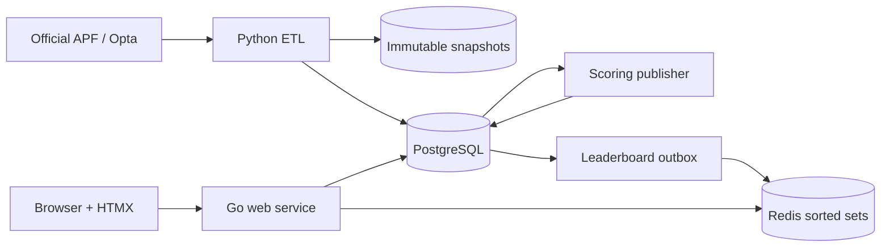

# Architecture

Go Football is a small monorepo with independently deployable web and data
processes. PostgreSQL is authoritative; Redis is a disposable real-time read
model.

## Boundaries

- **`cmd/web` and `internal/`**: the Go composition root, HTTP delivery, and
  leaderboard application code. HTML is rendered on the server; HTMX replaces
  only the leaderboard fragment and polls every 15 seconds. The same process
  serves local/Google sign-in and HTMX-enhanced authentication forms.
- **`etl/`**: an isolated Python package for source discovery, extraction, raw
  payload retention, and normalization. It does not serve web traffic.
- **`data/db/`**: PostgreSQL schema and ordered bootstrap migrations.
- **`data/sources/`**: source research and endpoint decisions, not runtime data.

## Request path and degradation

The leaderboard service reads a versioned Redis sorted set first, enriches UUID
members from PostgreSQL, and falls back to PostgreSQL ranking queries if Redis is
empty or unavailable. Tied entries share a competition rank; UUID ordering gives
stable pagination only. Authentication users, external identities, and hashed
opaque sessions are authoritative in PostgreSQL; Google uses authorization code
flow with PKCE. `/health/live` checks the process and `/health/ready` checks
PostgreSQL and Redis.

## Data flow

1. A scheduled Python job rediscovers active APF identifiers and fetches a
   gameweek or match detail.
2. The raw response is hashed and retained before normalized tables are changed
   transactionally.
3. A versioned scoring model publishes match and aggregate scores in PostgreSQL.
4. The same transaction appends `leaderboard_outbox` events.
5. A worker applies newer aggregate versions to Redis sorted sets. Redis can be
   rebuilt from PostgreSQL at any time.

Extraction, loading, scoring, and outbox consumption remain separate pipeline
stages so each can be retried idempotently. The current Python package implements
source extraction; the remaining stages should follow the invariants in
[`data/data-model.md`](../data/data-model.md).

## Deployment

The Go service is stateless and can have multiple replicas. Run ETL as a CronJob
or scheduled task, not as a sidecar. Keep PostgreSQL and Redis private, terminate
TLS at the ingress, and supply secrets through the deployment platform rather
than committed environment files.
