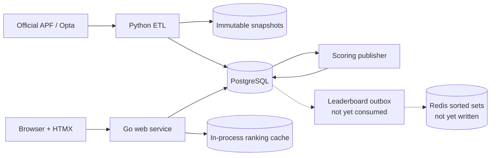

# Architecture

Go Football is a small monorepo with independently deployable web and data
processes. PostgreSQL is authoritative. The web process keeps a short-lived
in-process ranking cache; a Redis read model is designed but not implemented.

## Boundaries

- **`cmd/web` and `internal/`**: the Go composition root, HTTP delivery,
  leaderboard application code, and immutable season-award catalog/evaluator.
  HTML is rendered on the server; HTMX replaces only the leaderboard fragment
  and polls every 15 seconds. The same process serves local/Google sign-in and
  HTMX-enhanced authentication forms.
- **`etl/`**: an isolated Python package for source discovery, extraction, raw
  payload retention, and normalization. It does not serve web traffic.
- **`data/db/`**: PostgreSQL schema and ordered bootstrap migrations.
- **`data/sources/`**: source research and endpoint decisions, not runtime data.

## Request path and degradation

The leaderboard service keeps a short-lived in-process cache keyed by edition,
scoring model, position, and limit. On a miss it queries PostgreSQL. Tied entries
share a competition rank; UUID ordering gives stable pagination only.
Authentication users, external identities, and hashed opaque sessions are
authoritative in PostgreSQL; Google uses authorization code flow with PKCE.
`/health/live` checks the process and `/health/ready` checks PostgreSQL and Redis
connectivity.

A Redis sorted-set projection is defined in
[`data/data-model.md`](../data/data-model.md) and the reader exists in
`internal/leaderboard/redis.go`, but no writer does. `Service.rank` consults it
only for non-default scoring models, so with the default `SCORING_MODEL_ID=default`
it is never reached. Building it requires an outbox consumer, not a
configuration change.

## Data flow

1. A scheduled Python job rediscovers active APF identifiers and fetches a
   gameweek or match detail.
2. The raw response is hashed and retained before normalized tables are changed
   transactionally.
3. A versioned scoring model publishes match and aggregate scores in PostgreSQL.
4. The same transaction appends `leaderboard_outbox` events.
5. *(Not implemented.)* A worker would apply newer aggregate versions to Redis
   sorted sets. Until that worker exists, Redis holds no ranking data.

Extraction, loading, scoring, and outbox consumption remain separate pipeline
stages so each can be retried idempotently. The current Python package implements
source extraction; the remaining stages should follow the invariants in
[`data/data-model.md`](../data/data-model.md).

## Deployment

The Go service is stateless and can have multiple replicas. Run ETL as a CronJob
or scheduled task, not as a sidecar. Keep PostgreSQL and Redis private, terminate
TLS at the ingress, and supply secrets through the deployment platform rather
than committed environment files.
